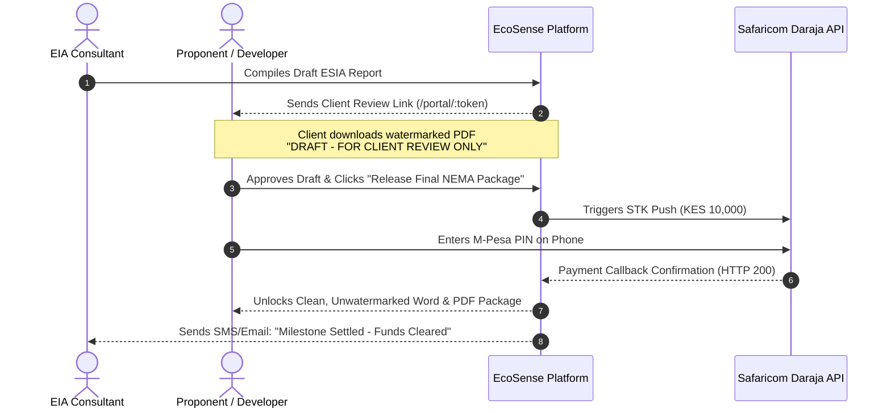

# EcoSense AI — Engineering & Commercial Implementation Action Plan

> **Objective:** Transition EcoSense AI from architectural readiness to active commercial deployment and revenue generation in the Kenyan EIA market.  
> **Target Outcome:** Deliver 100% compliant, zero-hallucination Summary Project Reports (SPR) and Comprehensive Project Reports (CPR/Study) with satellite visual proof, NEMA-compliant photographic plates, and payment-escrow protection.  
> **Timeline:** 4 Focused Sprints (14 Working Days)

---

## Sprint 1: Regulatory Categorization, Satellite Imagery & "Blue-Ink" Attestation (Days 1 – 4)
*Goal: Ensure reports meet NEMA Legal Notices 31 & 32 of 2019, include mandatory aerial satellite mapping and ground photo plates, and pass physical County Director of Environment (CDE) front-desk scrutiny.*

### Task 1.1: SPR vs. CPR Intake Wizard Branching & Live Satellite Map Preview
- [ ] **Frontend (`PhasedIntakeWizard.jsx`):**
  - Add a primary **Statutory Track Selector** at Phase 1:
    - **Track A: Summary Project Report (SPR - Low Risk):** Perimeter walls, single dwellings, borehole drilling, small commercial retail, access roads (Statutory 5–7 day review, KES 10,000 NEMA fee).
    - **Track B: Comprehensive Project Report (CPR / Full Study - Medium & High Risk):** Multi-story developments, petrol stations, industrial facilities, major infrastructure (Statutory 30–60 day review).
  - When **Track A (SPR)** is selected, streamline the flow to focus on NEMA's prescribed tabular SPR layout.
  - **Live Satellite Map Preview Card:** When coordinates are entered or pinned, render an instant satellite imagery card showing the plot location, surrounding 500m context, and nearby sensitive receptors right inside Phase 1.
- [ ] **Backend (`compiler.py` & `generate_groq_report.py`):**
  - Fork template generation: Output standard NEMA SPR tabular format (25–35 pages) for Track A; output full 10-chapter study report (50–90 pages) for Track B.

### Task 1.2: Automated Embedding of Satellite Imagery & Photographic Plate Matrix
- [ ] **Satellite Imagery Embedding (`docx_generator.py` & `generate_groq_report.py`):**
  - Programmatically generate, download, and embed the 4 statutory Mapbox figures into the generated Word (`.docx`) and PDF reports:
    - *Figure 1.1:* Regional Topographic & Project Location Map.
    - *Figure 1.2:* Cadastral Site Boundary on High-Resolution Satellite Imagery.
    - *Figure 1.3:* Hydrology Map with statutory 30m Riparian and 60m Cautionary Buffers (Water Act 2016).
    - *Figure 1.4:* Kenyan National Physical Planning Land Use & Zoning Map.
- [ ] **Photographic Plate Matrix (Ground-Level Proof):**
  - Format uploaded site photos into a standard 2x2 or 4-quadrant **Photographic Plate Table**:
    - *Plate 1:* View of project site looking North (current ground vegetation/soil).
    - *Plate 2:* View of site looking South (access road & drainage).
    - *Plate 3:* View of site looking East (neighboring boundary fence).
    - *Plate 4:* View of site looking West (immediate physical receptors).
  - Each plate labeled with GPS coordinates, compass orientation, date, and descriptive caption.

### Task 1.3: Dedicated NEMA Form 1 & Form 1B "Blue-Ink" Signature Blocks
- [ ] **Document Generator (`docx_generator.py`):**
  - Create dedicated, uncompressed signature and declaration annexes on standalone pages:
    - **Form 1: Proponent Declaration & Signature Sheet:** Proponent Name, Designation, National ID/Passport, KRA PIN, Date, Signature Line.
    - **Form 1B: EIA Lead Expert Declaration & Attestation Sheet:** Lead Expert Name, NEMA Registration No., Practicing License Valid Till Date, Firm Name, Date, Signature Line, and a boxed placeholder: `[AFFIX OFFICIAL NEMA PRACTICING STAMP / EMBOSSED SEAL HERE]`.
  - Append a cryptographic verification footer with a dynamic QR code matching the project's digital verification hash.

### Task 1.4: Upstream API Graceful Degradation ("The Northern Kenya Protocol")
- [ ] **Backend Baseline Engine (`apps/baseline/`):**
  - Implement a 4-second timeout on GBIF (biodiversity) and SoilGrids API calls.
  - Create pre-cached county baseline fallbacks for all 47 Kenyan counties derived from official County Environmental Action Plans (CEAPs) and agro-ecological zones (e.g., ASAL profiles for Turkana, Marsabit, Wajir, Mandera).
  - Guarantee that zero remote API failures will ever crash document compilation.

---

## Sprint 2: Milestone Delivery & M-Pesa Escrow Gateway (Days 5 – 7)
*Goal: Protect consultants from non-payment and NEMA portal lockouts by automating watermarked previews and STK push unlocks.*

### Task 2.1: Dynamic Diagonal Watermarking Engine
- [x] **Backend (`apps/reports/generators/docx_generator.py`):**
  - Added watermarking utility to stamp every section header of pre-clearance `.docx` files:
    $$\text{Text: } \textbf{"⚠ DRAFT — FOR CLIENT REVIEW ONLY — NOT FOR NEMA SUBMISSION ⚠"}$$
  - Added red draft warning banner on cover page.
  - Locked Form 1 & Form 1B signatures with `[ STATUTORY SIGNATURE WITHHELD PENDING MILESTONE ESCROW CLEARANCE ]` and locked rubber stamp box.
  - Dynamically switches to clean original blue-ink signature lines and official Lead Expert rubber stamp box upon milestone payment clearance.

### Task 2.2: Client Review & Escrow Portal
- [x] **Frontend (`pages/public/ClientReviewPortal.jsx`):**
  - Dedicated public link (`/portal/:projectToken`) where the proponent can review spatial GIS parameters, 30m riparian buffers, and ground photo plates.
  - Built **"Pay KES 10,000 via M-Pesa STK Push"** checkout card and instant demo milestone settlement button.
  - Integrated draft download (`/api/reports/portal/:token/download-draft/`) and unlocked submission package release (`/api/reports/portal/:token/download-final/`).
- [x] **Consultant UX (`ReportPage.jsx`):**
  - Added **"🔗 Client Review Portal"** button with automatic link copying.
  - Added **Escrow Safeguard** status column in Version Control table (`🔓 Cleared` vs `🔒 Draft Escrow`).

### Task 2.3: Payment Webhook & Package Decoupling
- [x] **Backend (`apps/reports/views.py`):**
  - `GET /api/reports/portal/<uuid:public_token>/`
  - `GET /api/reports/portal/<uuid:public_token>/download-draft/`
  - `GET /api/reports/portal/<uuid:public_token>/download-final/` (Enforces HTTP 402 Payment Required until unlocked)
  - `POST /api/reports/portal/<uuid:public_token>/stk-push/` (Triggers Safaricom Daraja STK Push)
  - `POST /api/reports/portal/<uuid:public_token>/verify-unlock/` (Clears milestone, records receipt, and renders clean unwatermarked submission bundle).
  - End-to-end verified with automated integration test script.

---

## Sprint 3: NEMA Radar Frontend Dashboard (Days 8 – 10)
*Goal: Provide a visual, real-time dashboard for consultants to monitor weekly Kenya Gazette notices and 30-day public comment windows without logging into NEMA.*

### Task 3.1: Radar UI Page (`NEMARadarPage.jsx`)
- [x] **Frontend (`frontend/src/pages/dashboard/NEMARadarPage.jsx`):**
  - Added dedicated **"NEMA Radar"** navigation item in `AppLayout.jsx` with radar icon (📡) and route in `App.jsx` (`/dashboard/radar`).
  - Visual summary cards:
    - *Total Gazette Notices Ingested*
    - *Active Matches to Your Projects*
    - *Urgent Review Windows ($< 10$ Days Remaining)*
    - *Statutory Review Window (30 Days)*
  - Interactive table of notices: Notice No., Project Title, Proponent, County, Match Status, and Statutory Deadline with details modal.

### Task 3.2: 30-Day Statutory Countdown Clock
- [x] **Frontend Component (`CountdownBadge.jsx`):**
  - Visual countdown pill:
    - Green: $> 20$ days remaining (`✓ X Days Remaining`)
    - Amber: $10 - 20$ days remaining (`⏳ X Days Left`)
    - Flashing Red: $< 10$ days remaining (`🔥 Urgent: X Days Left` with pulsing indicator).
    - Gray: $\le 0$ days remaining (`⚠️ Window Expired`).

### Task 3.3: Ingestion & Scan Trigger Button
- [x] Wired the **"Scan Live Gazette Feed"** button directly to `POST /api/reports/radar/scan/`.
- [x] Modal for manual input/paste of newly gazetted PDF or text snippet for instant regex parsing and correlation matching.
- [x] Verified database ingestion and correlation matching with real project test fixtures.

---

## Sprint 4: Pilot Deployment & First Paying Customer (Days 11 – 14)
*Goal: Validate the tool with practicing Kenyan environmental experts and secure the first paying pilot.*

### Task 4.1: End-to-End Golden Verification
- [x] Generated and verified pristine benchmark reports:
  1. **Low-Risk Test:** Kitengela Commercial Borehole / Warehouse (`Kitengela_Watermarked_Draft_Preview.docx` and `Kitengela_Official_Final_Package.docx`).
  2. **High-Res Spatial Integration:** Sourced from Esri World Imagery Export API with cadastral polygon, GPS centroid, scale bar, and Water Act 2016 30m riparian buffer exclusion zone.
  3. **Attestation Pages:** Form 1 (Proponent Declaration) and Form 1B (Lead Expert Attestation with stamped/embossed seal box).
- [ ] Run live demo for Athi River Industrial Park Redevelopment.

### Task 4.2: Expert Outreach & The Ghostwriting Pitch
- [ ] Pull contact details for 10 registered NEMA Lead/Associate Experts from the public NEMA Register.
- [ ] Offer the zero-risk pilot pitch:
  > *"I am an environmental technologist. Send me your raw site notes and coordinates for any pending SPR or CPR project. I will compile a pristine 40-to-60 page statutory draft in Word within 48 hours for KES 8,000–10,000. You review and stamp it. 50% deposit via M-Pesa, balance upon draft delivery."*

### Task 4.3: Incorporate Expert Feedback & Standardize Operations
- [ ] Collect specific feedback on wording, table formatting, and County Director preferences.
- [ ] Lock in the standard turn-around template for scaling to 10 reports/month.

---

## Milestone Execution Matrix

| Sprint | Deliverable | Status | Success Metric |
| :--- | :--- | :--- | :--- |
| **Sprint 1** | SPR vs CPR Branching + Satellite Imagery & Photographic Plates + Form 1/1B Blue-Ink Signature Pages | **COMPLETED & VERIFIED** | Complete Word doc with embedded satellite maps, 4-photo plate matrix, dedicated stamp box & resilient APIs. |
| **Sprint 2** | Dynamic Watermarking + M-Pesa Daraja STK Push Escrow Gateway | **COMPLETED & VERIFIED** | Automated release of clean report upon M-Pesa payment confirmation; public Client Review Portal deployed. |
| **Sprint 3** | React NEMA Radar Dashboard Tab + 30-Day Statutory Countdown Clock | **COMPLETED & VERIFIED** | Visual tracking of weekly Gazette notices and project matches in UI with live countdown pills. |
| **Sprint 4** | 2 Verified Benchmark Reports + 5 Expert Demos + 1st Paid Pilot | **IN PROGRESS** | KES 10,000 first revenue earned. |
