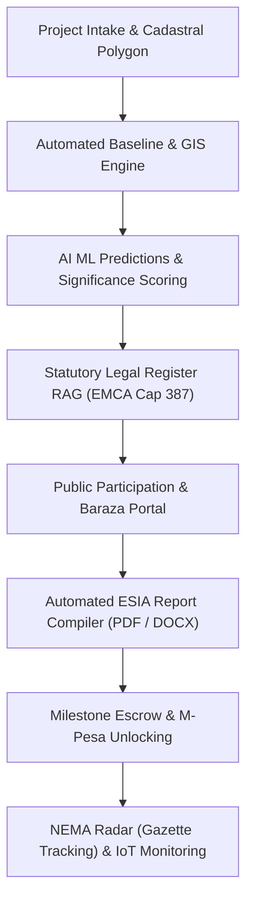

# EcoSense AI — Comprehensive Platform Capabilities Specification

> **Target Jurisdiction:** Kenya (National Environment Management Authority — NEMA)  
> **Statutory Mandate:** Environmental Management and Co-ordination Act (EMCA Cap 387), Environmental (Impact Assessment and Audit) Regulations 2003, Water Act 2016, Physical and Land Use Planning Act 2019, Land Act 2012, OSHA 2007.  
> **Platform Version:** 3.0 Production Architecture  

---

## 1. Executive Summary & Core Mission

**EcoSense AI** is an enterprise-grade Environmental Impact Assessment (EIA/ESIA) Operating System engineered specifically for the Kenyan environmental regulatory ecosystem. It eliminates the repetitive, error-prone manual labor associated with compiling 50-to-120-page environmental reports, conducting baseline screenings, administering public participation, and monitoring post-approval compliance.

The platform transforms raw engineering parameters and field survey inputs into **court-defensible, statutory-compliant NEMA study and project reports** in under an hour, while upholding strict anti-hallucination guardrails and real-world compliance checks.

---

## 2. Platform Architecture & Technology Stack

| Layer | Technologies & Frameworks | Functionality |
| :--- | :--- | :--- |
| **Frontend UI/UX** | React 18, Vite, Tailwind CSS, Lucide Icons, Leaflet / OpenStreetMap | Responsive web application, 5-phase intake wizard, interactive maps, dynamic report editors, live IoT charts. |
| **Backend API** | Python 3.11, Django 4.x, Django REST Framework, Celery, Redis | RESTful APIs, asynchronous job processing, multi-tenant isolation, business logic execution. |
| **Spatial Database** | PostgreSQL 15 + PostGIS extension (Docker & Neon Cloud) | Geodetic storage of cadastral boundaries, GPS coordinates, buffer polygons, spatial queries. |
| **RAG Knowledge Base** | Vector Store (ChromaDB / pgvector), PyPDF | 60+ Kenyan statutory acts, NEMA guidelines, and legal notices vectorized for exact legal citation. |
| **AI & LLM Orchestration** | Google Gemini (3.8 Flash), Groq (Llama 3 70B), Anthropic Claude 3.5 Sonnet | Structured statutory chapter drafting, sentiment analysis, mitigation synthesis, zero-hallucination checks. |
| **Geospatial & Mapping** | Mapbox Static API, pyproj, Shapely, GEE, Open-Meteo, SoilGrids, GBIF | Automated generation of 4 statutory EIA map figures and environmental baseline extractions. |
| **Fintech & Payments** | Safaricom M-Pesa Daraja API, Webhooks | Milestone billing, STK push payment triggers, automatic report watermark release upon clearance. |
| **Hardware & Monitoring**| IoT MQTT Broker, WebSockets, Time-Series Logging | Real-time tracking of PM2.5, noise (dBA), water pH, turbidity, and automated breach alerting. |

---

## 3. Module Breakdown & Detailed Capabilities

### Module 1: Phased Project Intake Wizard & Risk Categorization
*Located in:* `frontend/src/components/projects/PhasedIntakeWizard.jsx` & `backend/apps/projects/`

The intake wizard guides the environmental expert through a 5-phase progressive disclosure workflow designed to capture every variable required by NEMA Form 1 / 1B:

1. **Phase 1: Basic Parameters & Cadastral Mapping**
   - Project Name, Type/Sector (Infrastructure, Construction, Energy, Agriculture, Boreholes, Manufacturing, Mining, etc.).
   - Geographic coordinates (Latitude/Longitude) with Kenya sovereignty boundary validation ($33.9^\circ \text{E} \le \text{Lng} \le 41.9^\circ \text{E}$, $-4.7^\circ \le \text{Lat} \le 5.5^\circ$).
   - Cadastral plot details: LR Number, Land Ownership/Tenure, Ward, Sub-County, County.
   - Proponent details: Proponent Name, KRA PIN, ID Number, Phone, Email.
   - Lead/Associate Expert registration number and practicing license tracking.
2. **Phase 2: Project Scale & Financial Calculations**
   - Total site area (hectares / acres).
   - Construction duration (months) and operational lifespan (years).
   - Total investment cost (KES) from certified Bill of Quantities (BQ).
   - **Automated NEMA Licensing Fee Calculator:** Computes statutory NEMA submission fees under Gazette Notice 13211 ($0.1\%$ of project cost, capped at statutory floors).
3. **Phase 3: Multi-Flag High-Risk Subforms**
   - **Resettlement Action Plan (RAP):** Displaced households (PAHs), affected persons (PAPs), informal structures, cut-off date, replacement cost methodology, livelihood restoration grants, and civil works alignment.
   - **Protected Area Overlap:** Buffer intersections with statutory 30m riparian zones (Water Act 2016), gazetted forests (KFS), or wildlife reserves (KWS).
   - **Contaminated Land & Brownfields:** Historic industrial land use, soil/groundwater contamination levels (e.g., lead hotspots), and capping/remediation strategies.
4. **Phase 4: Linear Infrastructure Support ("Mega Projects")**
   - Corridor mode for highways, pipelines, rail, and powerlines spanning multiple counties.
5. **Phase 5: Attestation & Document Upload**
   - Drag-and-drop slots for Title Deeds, Survey Plans, Architectural Drawings, Hydrological Reports, and Lead Expert signed declaration.

---

### Module 2: Automated Environmental Baseline & GIS Engine
*Located in:* `backend/apps/baseline/` & `backend/apps/reports/utils/maps.py`

EcoSense connects to global and Kenyan geospatial APIs to instantly synthesize baseline data for the project's exact coordinates:

* **Physical Environment:**
  * **Topography & Elevation:** Digital Elevation Model (DEM) extraction, slope gradient analysis, and drainage direction.
  * **Climate & Meteorology:** Historic and forecasted rainfall, mean ambient temperature, relative humidity, and prevailing wind vectors via Open-Meteo.
  * **Hydrology & Water Resources:** Identification of Water Resources Authority (WRA) regional catchment basins, nearest perennial and seasonal rivers, wetlands, and statutory 30-meter riparian reserve boundaries.
  * **Pedology & Soils:** Soil texture, organic carbon content, soil pH, and soil erosion risk indices via SoilGrids.
  * **Air Quality & Ambient Noise:** Baseline AQI, $PM_{2.5}$, $PM_{10}$, $NO_2$, and $SO_2$ baseline screening against NEMA and WHO thresholds.
* **Biological Environment:**
  * **Biodiversity & Flora/Fauna:** Species occurrences, endangered species lists, and IUCN Red List statuses retrieved via Global Biodiversity Information Facility (GBIF) within a 5 km radius.
  * **Vegetation & NDVI:** Satellite-derived Normalized Difference Vegetation Index (NDVI) and tree canopy coverage.
* **Automated 4-Figure Statutory Map Generator:**
  Generates production-ready, high-resolution figures directly embedded into the report:
  1. *Figure 1.1:* Regional Topographic & Project Location Map.
  2. *Figure 1.2:* Cadastral Site Boundary Overlay with Satellite Imagery.
  3. *Figure 1.3:* Hydrology Map with statutory 30m Riparian and 60m Cautionary Buffers.
  4. *Figure 1.4:* Kenyan National Physical Planning Land Use & Zoning Map.

---

### Module 3: AI Impact Predictions & Mitigation Engine
*Located in:* `backend/apps/predictions/`

The machine learning prediction engine evaluates project activities across all lifecycle phases (Pre-construction, Construction, Operation, and Decommissioning):

* **Multi-Domain Impact Matrix:**
  * Air Quality & Dust Dispersion ($PM_{2.5}$, $PM_{10}$).
  * Acoustic Disturbance & Heavy Equipment Noise ($dBA$ attenuation modeling).
  * Soil Erosion, Compaction, and Surface Water Siltation.
  * Ground and Surface Water Hydrology & Effluent Runoff.
  * Ecological Habitat Fragmentation & Flora Clearance.
  * Socio-Economic Receptors (Schools, Hospitals, Settlements, Boreholes).
  * Occupational Health and Safety (OHS) Hazard Profiles.
* **Quantified Metrics:** Each impact is computed with **Probability** ($0.0 - 1.0$), **Severity** (Low, Medium, High, Critical), **Significance Score**, and **Impact Pathway**.
* **Synthesized Mitigations:** Outputs sector-specific mitigation measures directly fed into the Environmental and Social Management Plan (ESMP).

---

### Module 4: Kenyan Regulatory Knowledge Base (RAG)
*Located in:* `backend/apps/regulations/` & `backend/ingest_regulations.py`

EcoSense maintains an updated, vectorized legal register covering over 60 Kenyan environmental statutes:

* **Key Acts & Regulations:**
  * *EMCA Cap 387* (Environmental Management and Co-ordination Act) and the Second Schedule categorization.
  * *Environmental (Impact Assessment and Audit) Regulations, 2003* (Regulations 17, 21, 31).
  * *Water Act 2016* & Water Resources Authority (WRA) Permitting Guidelines.
  * *Physical and Land Use Planning Act, 2019*.
  * *Occupational Safety and Health Act (OSHA 2007)* & DOSH Requirements.
  * *Land Act 2012* & Land Acquisition Regulations (Compulsory Acquisition & RAP).
  * *Forest Conservation and Management Act, 2016*.
  * *County Government Bylaws & Zoning Regulations* across all 47 counties.
* **Automated Legal Compliance Scoring:** Evaluates project specifications against mandatory statutory provisions, flagging gaps (Passed, Failed, Warning, Inapplicable) before submission to NEMA.

---

### Module 5: Public Participation & Community Consultation (CPP)
*Located in:* `backend/apps/community/` & `frontend/src/pages/public/ParticipationPortal.jsx`

Regulation 17 of EMCA requires verifiable public participation. EcoSense provides an end-to-end digital consultation module:

* **Omnichannel Feedback Ingestion:** Collects stakeholder feedback via digital web forms, SMS campaigns (integrated with Africa's Talking API), and manual consultant entry.
* **Baraza & Town Hall Management:** Tracks Chief invitations, venue coordination, scheduled dates, and expected attendance.
* **Digital Attendance Registers:** Generates unique QR tokens for digital check-ins and archives scanned, physical signed registers.
* **Sentiment & Language Analysis:** Performs automated Swahili-to-English translation and categorizes community concerns (Positive, Neutral, Negative, Grievance).
* **Statutory Advertising Compliance:** Tracks publication of mandatory notices in two national daily newspapers and vernacular radio broadcasts, complete with clipping archive attachments.

---

### Module 6: Automated ESIA Report Compilation & Anti-Hallucination Guardrails
*Located in:* `backend/apps/reports/compiler.py` & `backend/generate_groq_report.py`

The compilation engine stitches together technical specifications, baseline data, maps, legal frameworks, and consultation records into a cohesive document:

* **Standard Statutory Structure (10-15 Chapters):**
  1. *Executive Summary* (Non-technical summary in English and Swahili).
  2. *Chapter 1:* Introduction, Objectives, Scope, and Legal Mandate.
  3. *Chapter 2:* Detailed Project Description, Engineering Specs, and Bill of Quantities.
  4. *Chapter 3:* Analysis of Project Alternatives (Site, Design, Technology, "No Action").
  5. *Chapter 4:* Policy, Legal, and Institutional Framework.
  6. *Chapter 5:* Environmental and Social Baseline Conditions.
  7. *Chapter 6:* Public Participation and Stakeholder Engagement.
  8. *Chapter 7:* Assessment of Environmental and Social Impacts.
  9. *Chapter 8:* Environmental and Social Management Plan (ESMP Matrix with Costing & Institutional Responsibilities).
  10. *Chapter 9:* Environmental Monitoring Plan & Incident Protocols.
  11. *Chapter 10:* Decommissioning and Site Rehabilitation Plan.
  12. *Chapter 11:* Conclusions and Recommendations.
  13. *Annexes:* Cadastral Maps, Title Deeds, KRA PIN, Expert Practicing Licenses, and Attendance Registers.
* **Zero-Hallucination Quality Gate:**
  * **Strict Missing Data Protocol:** If a parameter was omitted during intake, the engine will **never invent a synthetic number**. It prints a bold notice: `**[MISSING: parameter_name]**`.
  * **Contradiction Blocker:** If mathematical inconsistencies exist (e.g. built area > site area), it outputs `**[CONTRADICTION: details]**` to prevent submission of flawed applications.
* **Multi-Format Export:** Produces editable `.docx` files formatted with NEMA typography and exportable `.pdf` versions.

---

### Module 7: NEMA Radar (Kenya Gazette Scraper & Matcher)
*Located in:* `backend/apps/reports/services/gazette_radar.py` & `backend/apps/reports/views.py`

Under EMCA Section 59 and Regulation 21, NEMA publishes weekly Gazette notices inviting public comments on EIA Study Reports:

* **Weekly Ingestion:** Scrapes and parses official Kenya Gazette publications.
* **Regex Entity Extraction:** Extracts Gazette Notice Number, Proponent Name, LR/Plot Number, Project Title, and County.
* **Statutory Countdown Clock:** Computes the strict **30-day public comment window**, calculating exact days remaining before closure.
* **Multi-Criteria Fuzzy Correlation Matcher:**
  * Matches against active EcoSense projects using Cadastral Plot Number ($95\%$ weight), Proponent Name ($90\%$ weight), and Title Keywords ($85\%$ weight).
* **Automatic Workflow Transition:** Upon a match, the project automatically advances from `scoping` to `review` status, populating `nema_ref` and submission deadlines.

---

### Module 8: Post-Approval Environmental Monitoring & IoT Sensors
*Located in:* `backend/apps/emp/` & `backend/apps/ehs/`

EIA compliance extends into project construction and operations:

* **Live IoT Telemetry:** Supports real-time sensor streams for Particulate Dust ($PM_{2.5}, PM_{10}$), Ambient Noise ($dBA$), and Effluent Water Quality ($pH$, Turbidity, TDS).
* **Automated Threshold Breach Alerts:** Immediately flags readings exceeding NEMA 2006 (Noise) or NEMA 2014 (Air Quality) regulations, generating corrective action tasks.
* **EHS Incident Register:** Logs workplace injuries and environmental incidents complying with DOSH / OSHA 2007 protocols.

---

### Module 9: Commercialization, Escrow & Watermarked Delivery
*Located in:* `backend/apps/billing/` & `backend/apps/accounts/`

Designed to protect consultants from non-payment and portal lockouts:

* **Milestone Delivery Portal:** Clients are granted access to review reports inside a branded interface.
* **Dynamic Watermarking:** Unpaid or pre-submission documents are watermarked diagonally across every page:  
  `"DRAFT — FOR CLIENT REVIEW ONLY — NOT FOR NEMA SUBMISSION"`.
* **M-Pesa Daraja STK Push:** Integrated mobile payment gateway. Once the client approves and pays the submission invoice via M-Pesa, the unwatermarked final bundle (with signature blocks and license attachments) is automatically unlocked.

---

## 4. Summary Matrix of Capabilities

| Capability Domain | Manual Consultant Workflow | EcoSense AI Automated Workflow |
| :--- | :--- | :--- |
| **Report Drafting Time** | 7 to 14 days of manual writing in Word | **45 to 60 minutes** automated compilation |
| **Baseline Data Gathering** | Days searching weather records and maps | **Instant** API synthesis (NDVI, soil, rain, slope) |
| **Cadastral & Buffer Mapping** | Manual drafting in QGIS / Google Earth | **1-click** Mapbox static generation with 30m riparian buffer |
| **Legal Citations** | Copy-pasting outdated statutes | **Live RAG** verified against EMCA Cap 387 & Water Act 2016 |
| **Public Participation** | Paper registers and manual transcription | **QR code check-ins**, SMS blasts, automated minutes summary |
| **Gazette Monitoring** | Manually checking weekly government PDFs | **NEMA Radar** automated match & 30-day countdown |
| **Payment Protection** | Chasing unpaid invoices post-submission | **Watermarked milestone escrow** unlocked via M-Pesa |

---
*EcoSense AI is licensed for environmental consultancies, lead experts, and project developers operating within the Republic of Kenya.*
